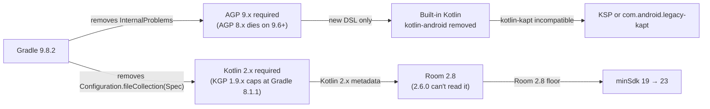

# TVHClient — Requirements to move to the latest toolchain

> [!IMPORTANT]
> This is **not** a Gradle version bump. Gradle 9.6+ removed an internal API
> (`org.gradle.api.problems.internal.InternalProblems`) that **AGP 8.x depends on**, and Gradle 9 removed
> the `Configuration.fileCollection(Spec)` API that **Kotlin Gradle Plugin 1.9.x** calls. Together those
> force a chain reaction: new Gradle → new AGP → built-in Kotlin → KSP → new Kotlin → new Room/Dagger.

## 1. The coupling chain

## 2. Target stack (latest stable, Oct 2026)

| Component | Current | Target | Notes |
| --- | --- | --- | --- |
| Gradle | 8.13 | **9.8.2** | 9.5.1 is what `gradle-wrapper.properties` points at right now |
| AGP | 8.13.2 | **9.5.1** | AGP 9.3 requires Gradle ≥ 9.5.0, supports API ≤ 37 |
| Kotlin | 1.9.24 | **2.4.21** | KGP 2.4.21 supports Gradle 7.6.3–9.7.0, AGP 8.5.2–9.3.1 |
| KSP | — | **2.3.13** | AGP 9 migration requires KSP ≥ 2.3.6 |
| JDK | 21 | **21** | AGP 9 min/default is 17; Gradle 9.8 runs on 21/25 |
| compileSdk / targetSdk | 34 | **37** | API 37 platform already installed; AGP 9.3+ supports it |
| Build Tools | 35.0.0 | **36.0.0** | |
| NDK | 30.0.16248370 | 28.2.13676358 (or keep 30) | only matters for Phase 2 FFmpeg |

## 3. Build-script changes required

### 3.1 AGP 9 DSL migration (all modules: `app`, `data`, `htsp`, + 5 fork modules)

| Old | New |
| --- | --- |
| `compileSdkVersion 34` | `compileSdk = 34` |
| `minSdkVersion 19` / `targetSdkVersion 34` | `minSdk = 23` / `targetSdk = 37` |
| `lintOptions { }` | `lint { }` |
| `kotlinOptions { jvmTarget = "17" }` | `kotlin { compilerOptions { jvmTarget = … } }` |
| `setProperty("archivesBaseName", …)` | `base { archivesName = … }` — **already done** |
| `applicationVariants` / `libraryVariants` | `androidComponents.onVariants { }` |

### 3.2 Plugins (built-in Kotlin)

- **Remove** `id 'kotlin-android'` from [app/build.gradle](file:///home/rsiebert/projects/TVHClient/app/build.gradle#L3), [data/build.gradle](file:///home/rsiebert/projects/TVHClient/data/build.gradle#L3), [htsp/build.gradle](file:///home/rsiebert/projects/TVHClient/htsp/build.gradle#L3) — AGP 9 compiles Kotlin itself.
- **Remove** `id 'kotlin-kapt'` — it is incompatible with built-in Kotlin. Either migrate to **KSP** (preferred) or swap in **`com.android.legacy-kapt`** pinned to the AGP version.
- `kotlin-parcelize` usage in [htsp/build.gradle](file:///home/rsiebert/projects/TVHClient/htsp/build.gradle#L4) needs verifying under built-in Kotlin.

### 3.3 gradle.properties

| Key | Action |
| --- | --- |
| `android.defaults.buildfeatures.buildconfig=true` | **removed in AGP 9** → add `buildFeatures { buildConfig = true }` per module |
| `kapt.incremental.apt`, `kapt.include.compile.classpath` | drop with kapt |
| `android.enableJetifier=true` | drop (jetifier is gone; needs fully-AndroidX deps) |
| `android.nonTransitiveRClass=false`, `android.nonFinalResIds=false` | verify against AGP 9 |

### 3.4 Annotation processing (the riskiest part)

- **Room** ([data/build.gradle](file:///home/rsiebert/projects/TVHClient/data/build.gradle#L38)) — `kapt "androidx.room:room-compiler"` → KSP.
- **Dagger** — *removed entirely* (see §9). The tiny DI graph was replaced by a hand-rolled `DataContainer`; no annotation processor needed.
- With `kapt` + Kotlin ≥ 2.3, Room 2.8 hits a metadata ceiling
  (`kotlin-metadata-jvm:2.2.0`, "maximum supported version is 2.2.0"). **KSP avoids this entirely.**

### 3.5 ExoPlayer fork (must move too)

> [!WARNING]
> The fork cannot stay on AGP 8.13. The main build's Gradle drives the included build, so once TVHClient
> is on Gradle ≥ 9.6, the fork's AGP 8.13.0 fails on `InternalProblems`. Both repos move together.

- AGP 8.13.0 → 9.x in [ExoPlayer/build.gradle](file:///home/rsiebert/projects/ExoPlayer/build.gradle)
- **Remove `AndroidSourceSet.jni`** — deleted in AGP 9. Affects
  [extensions/ffmpeg/build.gradle](file:///home/rsiebert/projects/ExoPlayer/extensions/ffmpeg/build.gradle) (`jni.srcDirs = []`).
  `jniLibs.srcDir 'src/main/libs'` stays.
- `compileSdkVersion` → `compileSdk`, `lintOptions` → `lint` in all 5 module scripts.

## 4. Library upgrades

| Library | Current | Latest |
| --- | --- | --- |
| Room | 2.6.0 | **2.8.5** |
| Dagger | 2.48.1 | **removed** (replaced by `DataContainer`) |
| kotlinx-coroutines-android | `1.6.0-native-mt` | **1.11.0** |
| material | 1.4.0 | 1.14.0 |
| appcompat | 1.4.0 | 1.8.0 |
| core-ktx | 1.7.0 | 1.19.1 |
| fragment | 1.4.0 | 1.9.1 |
| lifecycle | 2.4.0 | 2.11.0 |
| work-runtime | 2.7.1 | 2.12.0 |
| recyclerview | 1.2.1 | 1.4.0 |
| preference-ktx | 1.1.1 | 1.2.1 |
| constraintlayout | 2.1.2 | 2.2.2 |
| annotation | 1.3.0 | 1.11.0 |
| viewpager2 | 1.0.0 | 1.1.0 |
| billing | 6.1.0 | 9.1.0 |
| play-services-cast-framework | 21.0.0 | 23.0.0 |
| mediarouter | 1.2.5 | 1.8.1 |
| firebase (individual) | 18.x/19.x/20.x | **BOM 35.1.0** |
| google-services | 4.4.0 | 4.5.0 |
| crashlytics-gradle | 2.8.1 | 3.0.8 |
| perf-plugin | 1.4.1 | 2.0.2 |
| timber / picasso | 5.0.1 / 2.71828 | already latest |

## 5. Blocking / unmaintained dependencies

> [!CAUTION]
> These need a decision, not just a version bump.

- **`kotlinx-coroutines-android:1.6.0-native-mt`** — the `-native-mt` artifact was discontinued after 1.6.0.
  Switch to plain `kotlinx-coroutines-android:1.11.0`.
- ~~**`com.afollestad.material-dialogs:3.3.0`**~~ — **done**: replaced with Material Components
  (`MaterialAlertDialogBuilder`) across 18 files (see §9).
- ~~**`com.mikepenz:materialdrawer:7.0.0`**~~ — **done**: replaced with `DrawerLayout` + `NavigationView` (see §9).
- **`play-services-cast-framework:21.0.0`** — still references the old support library (Jetifier rewrites it).
  Bump to 23.0.0 so Jetifier can be dropped.
- **ExoPlayer 2.11.7 fork** — a 2019 snapshot of a library that is now **`androidx.media3` 1.11.1**. Keeping
  the fork means maintaining an AGP-9 build of dead code; migrating to Media3 would remove the fork, the
  composite build, and Phase 2 FFmpeg work entirely.

## 6. Platform-level consequences

- **minSdk 19 → 23** (Room 2.8 floor). Side effects: drops Android 4.4–6.0; `androidx.multidex` becomes
  unnecessary (native multidex since API 21).
- **compileSdk/targetSdk 34 → 37** brings behaviour requirements (edge-to-edge enforcement, predictive back,
  foreground-service and background restrictions) that are *runtime* work, not build work.
- **Java default source/target 8 → 11** (project already targets 17).

## 7. Suggested sequencing

> [!TIP]
> Kotlin 2.4.21 + AGP 8.13.2 + Gradle 8.13 **is a supported combination**, so the migration can be split
> instead of done big-bang.

1. **Kotlin & libraries first** — Kotlin 1.9.24 → 2.4.21 on Gradle 8.13 / AGP 8.13.2; fix language
   breakages; bump Room 2.8.5 + Dagger 2.60.1; raise minSdk to 23; drop the `databinding-ktx` exclusion
   (no longer needed once Kotlin ≥ 2.2). Still no AGP 9.
2. **kapt → KSP** while still on AGP 8 (smaller blast radius).
3. **Toolchain flip** — Gradle 9.8.2 + AGP 9.5.1; adopt built-in Kotlin; apply the DSL renames (§3.1);
   clean `gradle.properties` (§3.3).
4. **Fork flip** — ExoPlayer to AGP 9 (§3.5).
5. **compileSdk/targetSdk 37** + remaining library bumps + targetSdk behaviour work.

## 8. Decisions (confirmed)

| Question | Decision |
| --- | --- |
| targetSdk | **37** — required |
| minSdk | **19 → 23** |
| ExoPlayer fork | **Migrate to `androidx.media3` 1.11.1** — the fork holds no library-code changes |
| Unmaintained libraries | **Replace** material-dialogs (18 files) and materialdrawer (1 file) — *both done* |
| Annotation processing | **KSP** — not `com.android.legacy-kapt` |
| Cast | Keep `play-services-cast-framework` at **21.0.0** for now; the 23.0.0 bump is **deferred to Step 6** (it forces compileSdk 37 + minSdk 24 + a beta `mediarouter`). Cast is a live feature (9 files); `media3-cast` is an optional later step |

### Evidence: the fork carries no patches

The fork's only non-upstream commits are:

| Commit | Effect |
| --- | --- |
| 3 × merge | sync with `google/ExoPlayer release-v2` |
| `af157e36b` | renamed the Gradle **group** to `org.tvheadend.tvhclient` |
| `548bf7247`, `7b975febe`, `51d9bddc1` | Bintray publishing setup |
| `09537837b` | Gradle version bump |
| `eb15c1ced` | FFmpeg **build script** tweaks (x86_64, clean first) |

**Zero changes to ExoPlayer's library code** — it is upstream 2.11.7 repackaged so it could be published
under the app's own coordinates. Nothing proprietary is lost by migrating.

### `kapt` → **KSP** (why)

`kapt` generates Java stubs and runs annotation processors via `javac` — slow, and the source of the
metadata-version errors already hit. KSP reads Kotlin symbols directly: faster, no metadata ceiling, and the
only supported path in Room 3.0. It also decouples us from `com.android.legacy-kapt`, which would keep both
the stub pipeline and the metadata ceiling.

### Revised sequencing

1. **Kotlin & libraries** — Kotlin 2.4.21 + Room 2.8.5 + Dagger 2.60.1 + coroutines 1.11.0, still on
   Gradle 8.13 / AGP 8.13.2; minSdk → 23; drop the `databinding-ktx` workaround.
2. **kapt → KSP** for Room + Dagger (still AGP 8 — smaller blast radius).
3. **Toolchain flip** — Gradle 9.8.2 + AGP 9.5.1; built-in Kotlin; DSL renames; `gradle.properties` cleanup.
4. **Media3 migration** — retires the fork, the composite build and Phase 2.
5. **Dialog/drawer replacement** + remaining library bumps.
6. **targetSdk 37** behaviour work.

> [!NOTE]
> Steps 1–2 above were executed as written (Dagger bumped to 2.60.1, then moved to KSP), but Dagger was
> **subsequently removed entirely** (`06a570026`) — the graph was too small to justify it. Step 5's drawer
> replacement is also **done** (`eb0ab74a2`), as is the material-dialogs replacement (`ec3bcfd20`); only the library bumps remain.

### Traps to expect

> [!WARNING]
> - **Room 2.8.5 + kapt + Kotlin 2.4** hits the `kotlin-metadata-jvm` ceiling (Room ships 2.2.0; Kotlin 2.4
>   emits 2.4.0). Either pin `kotlin-metadata-jvm` on the processor configuration, or do step 2 immediately.
> - **Room 2.8.5 may force compileSdk ≥ 35** via the AAR metadata check.
> - **Media3's FFmpeg extension is build-it-yourself**, so Phase 2 does not fully disappear if FFmpeg audio is
>   wanted. Note `EXTENSION_RENDERER_MODE_PREFER` is set in
>   [PlayerViewModel.kt](file:///home/rsiebert/projects/TVHClient/app/src/main/java/org/tvheadend/tvhclient/ui/features/playback/internal/PlayerViewModel.kt#L132).
> - **Kotlin 2.4 removes the K1 compiler** — 2019-era sources may need source fixes.

## 9. Work log

- [x] Decisions folded in (§8).
- [x] **Step 1 — Kotlin/libraries** — `6db1aaa22` (fork: `2879ca46c`).
- [x] **Step 2 — kapt → KSP** — `5a0724caf`.
- [x] **Step 3 — Gradle 9.8.2 + AGP 9.5.1** — `506611170` (fork: `d952d9e8e`).
- [x] **Build-config simplification** — `6feff603e`.
- [x] **Dagger removal** — `06a570026` (hand-rolled `DataContainer`).
- [x] **MaterialDrawer → `NavigationView`** — `eb0ab74a2`.
- [x] **Build deps + test infra** — `c8318bf8a`, `28e1e9a51`.
- [x] **Docs + `.gitignore`** — `6370072df`, `9a71fac31`.
- [x] **material-dialogs → Material Components** — `ec3bcfd20`.
- [ ] Step 4 — Media3 migration.
- [ ] Step 5 — library bumps (dialogs + drawer done).
- [ ] Step 6 — targetSdk 37 behaviour.

`./gradlew :app:assembleDebug` is green on the committed state (Gradle 9.8.2, AGP 9.5.1, Kotlin 2.4.21).

### Build-config simplification (`6feff603e`)

| Change | Detail |
| --- | --- |
| Version catalog | [libs.versions.toml](file:///home/rsiebert/projects/TVHClient/gradle/libs.versions.toml) is now the single source of truth for SDK levels and library versions; `app`/`data`/`htsp` reference `libs.*` instead of `rootProject.ext.*` and inline strings. The root `ext` block is down to three plugin versions. |
| `kotlin-stdlib-jdk8` | Dropped — an empty shim since Kotlin 1.8. |
| `lifecycle-common-java8` | Dropped — empty since Lifecycle 2.4; `BillingDataSource` moved off `@OnLifecycleEvent` to `DefaultLifecycleObserver`. |
| Duplicate plugin application | Removed the second `apply plugin: 'com.google.gms.google-services'`. |

> [!NOTE]
> A version catalog **cannot** be read from inside a `buildscript {}` block, so the AGP/Kotlin/KSP/Firebase
> plugin versions still live there. Moving those too requires the root `plugins { alias(...) apply false }`
> migration.

**Side effect worth knowing:** the IDE immediately flagged 24 stale versions in the catalog, so step 5's
library bumps are now a single-file edit.

### What actually broke, and the fix

| # | Symptom | Cause | Fix |
| --- | --- | --- | --- |
| 1 | `OutOfMemoryError: Metaspace` in D8 / Kotlin compile | Kotlin 2.x + AGP need far more than the 512 MB metaspace | `org.gradle.jvmargs` / `kotlin.daemon.jvmargs` → 1 GB metaspace |
| 2 | `Using multiple versions of AGP (8.13.0, 8.13.2) is not allowed` | A composite build requires an identical AGP in both builds | Bumped the fork to match |
| 3 | `Duplicate class kotlinx.android.parcel.*` | MaterialDrawer 7 pulls `kotlin-android-extensions-runtime` 1.3.61 | Removed the app's last `kotlinx.android.extensions.LayoutContainer` use, then excluded the legacy runtime. *(Exclude now gone — MaterialDrawer removed in `eb0ab74a2`.)* |
| 4 | `Unresolved reference 'BR'` | Data Binding's `BR`/binding classes come from an annotation processor — **KSP support is not planned** | kapt kept in `app`; under AGP 9 via `com.android.legacy-kapt` |
| 5 | `Could not create plugin of type 'FirebasePerfPlugin'` | Old Firebase/Google Gradle plugins can't be instantiated under AGP 9 | google-services → 4.5.0, crashlytics-gradle → 3.0.8, perf-plugin → 2.0.2 |
| 6 | `getDefaultProguardFile('proguard-android.txt') is no longer supported` | Removed in AGP 9 (it embedded `-dontoptimize`) | Switched to `proguard-android-optimize.txt` — **release builds now run R8 optimisations** |

### Carry-forward notes

> [!WARNING]
> - **`app` cannot be kapt-free** while it uses Data Binding. AGP 9 forbids `kotlin-kapt`, so the module
>   uses `com.android.legacy-kapt`. Isolating Data Binding into its own module is the only way to remove it.
> - **Release builds now run R8 optimisations** (fix #6). The release build has not been exercised — keep
>   rules may need attention.
> - `android.enableJetifier` is deprecated but still accepted under AGP 9, so the `play-services-cast-framework`
>   21.0.0 → 23.0.0 bump stays in step 5.
> - `android.nonFinalResIds=false` is also deprecated; it will need attention before Gradle 10.

## 10. Remaining work

### Step 4 — Media3 migration (largest)

Replace ExoPlayer 2.11.7 with `androidx.media3` **1.11.1** — ~24 Kotlin files plus 3 layout XMLs.

Retires in one go:

- the ExoPlayer **fork repository**
- `includeBuild('../ExoPlayer')` and the 4 `substitute` rules in
  [settings.gradle](file:///home/rsiebert/projects/TVHClient/settings.gradle)
- the fork's machine-specific `local.properties`
- the **AGP-version lockstep** constraint between the two builds (already broke the build twice)
- Phase 2 (native FFmpeg) — *unless* FFmpeg audio is wanted, since Media3's FFmpeg extension is
  build-it-yourself

### Step 5 — unmaintained libraries + remaining bumps

| Item | Scope | Note |
| --- | --- | --- |
| ~~material-dialogs → Material Components~~ | ~~18 files~~ | **Done** (`ec3bcfd20`). `MaterialAlertDialogBuilder`; custom RecyclerView adapters wrapped via `setView`; folder chooser reimplemented with `java.io.File`. |
| ~~materialdrawer → `DrawerLayout` + `NavigationView`~~ | ~~1 file~~ | **Done** (`eb0ab74a2`). Connection switcher moved to a header `Spinner`; count badges shown in item titles (drawer `NavigationView` has no badge API). |
| Library version bumps | 1 file | 24 stale versions flagged in `libs.versions.toml` — e.g. appcompat 1.4.0 → 1.8.0, core-ktx 1.7.0 → 1.19.1, billing 6.1.0 → 9.1.0 |
| Cast 21.0.0 → 23.0.0, then drop `enableJetifier` | 9 files (compile) | **Deferred to Step 6** — 23.0.0 forces compileSdk 37 + minSdk 24 + a beta `mediarouter`. Must land with the jetifier drop |
| `android.nonTransitiveRClass=true` | build files | Faster builds; may need explicit `R` imports |

### Step 6 — targetSdk 37

`compileSdk` 34 → 37 (AGP 9.5.1 supports API 37), then clear the behaviour changes for **35, 36 and 37 in a
single jump**: edge-to-edge enforcement, predictive back, foreground-service types — plus the
`nonFinalResIds` deprecation ahead of Gradle 10.

### Verification debt

These landed **compile-verified only**, and the first three sit on runtime paths.

> [!WARNING]
> 1. ~~**MaterialDrawer's excluded runtime**~~ — **resolved**: MaterialDrawer is gone, so the excluded
>    `kotlin-android-extensions-runtime` and its runtime risk are gone too.
> 2. **`BillingDataSource.onResume`** — the `@OnLifecycleEvent` → `DefaultLifecycleObserver` migration
>    changes the purchase-refresh-on-resume path.
> 3. **EPG screen** — `LayoutContainer` was removed from `EpgVerticalRecyclerViewAdapter`.
> 4. **Release build** — AGP 9 forced `proguard-android-optimize.txt`, so release builds now run R8
>    optimisations for the first time, against keep rules that have never been exercised.

### Optional / structural

- **View Binding instead of Data Binding** — the only route to a kapt-free `app` (drops `legacy-kapt`). Costs
  the 258-expression refactor across at least 12 layouts plus their `@BindingAdapter`s.
- **Plugin versions into the catalog** — needs the root `plugins { alias(...) apply false }` migration.
- ~~**Consolidate the two DI systems**~~ — **done**: Dagger removed (`06a570026`); only the hand-rolled
  `AppContainer` remains (still holds a `GlobalScope` worth revisiting).

### Housekeeping

- **Nothing has been pushed** to either remote.
- Uncommitted: only `.idea/misc.xml` and `.idea/deploymentTargetSelector.xml` (tracked IDE files).
